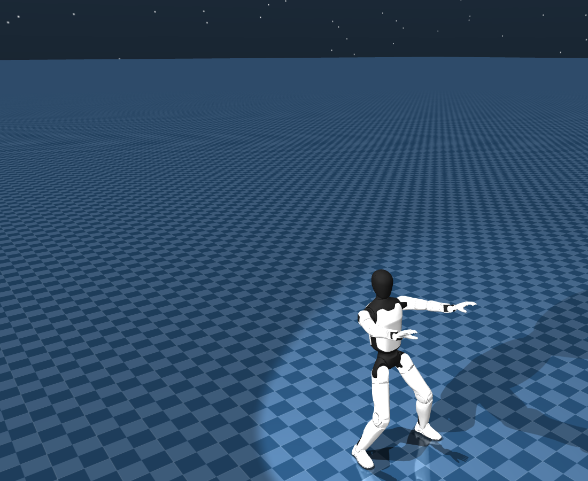
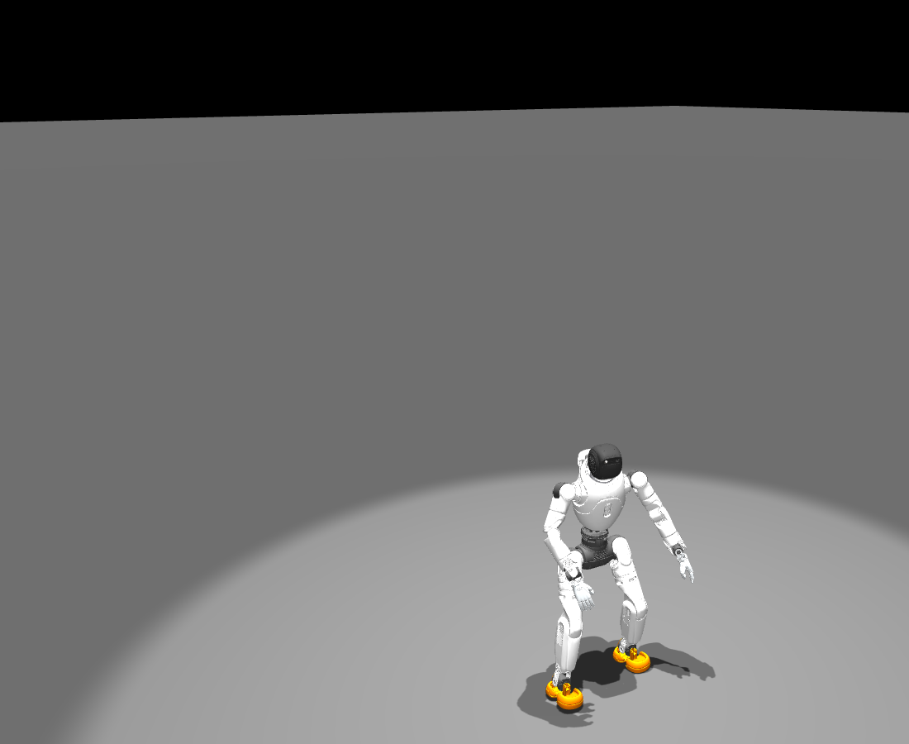

# AgiBot ONNX 动作播放器（灵犀 X2 / 远征 A3）

在 PC 浏览器里直接播放智元（AgiBot）**灵犀 X2** 与 **远征 A3** 的动作类 ONNX 资源：
不需要连接机器人、不需要部署，选中一个 ONNX 文件即可看到策略闭环驱动 3D 机器人跟踪动作。

底层基于 [mjswan](https://github.com/ttktjmt/mjswan)（Apache-2.0）：
浏览器内 **MuJoCo WASM 物理 + ONNX Runtime Web 推理 + three.js 渲染**，
参考动作由 mjswan 原生 tracking 命令驱动，观测/动作只写策略契约胶水。




## 下载

**[Windows x64 便携包（Releases）](https://github.com/AlanZhang8456/agibot-onnx-player/releases/latest)**

解压后双击 `AgiBotONNXPlayer.exe`，目标电脑**不需要安装 Python**：

1. 首次启动把播放器前端/模型模板展开到 `%LOCALAPPDATA%\AgiBotONNXPlayer`；
   若该目录不可写会自动回退到 exe 同目录 `data\`。
2. 浏览器自动打开「打开文件」页 <http://127.0.0.1:8767/library>。
3. 用「选择 ONNX 文件…」打开你自己的动作资源；A3 资源需要同目录配套 CSV。
4. 打开一个文件只准备该资源（A3 约 1~3 秒、X2 约 0.2~1 秒，缓存后秒开），不会重建整站。

> 播放器**不附带**任何动作资源；X2/A3 动作 ONNX 请使用你自己的文件或官方资源渠道。
> exe 未做代码签名，SmartScreen 可能提示“未知发布者”，选择“仍要运行”即可。

## 支持的资源

| 类型 | 识别依据 | 说明 |
| --- | --- | --- |
| 灵犀 X2 动作 | 输入 `obs[1,151]`（25-DOF 为 131）+ `time_step[1,1]`，输出含 `joint_pos/joint_vel/body_*_w` | 从 ONNX 参考分支提取动作轨迹，并生成 `time_step` 循环包装 ONNX，浏览器中闭环跟踪 |
| 远征 A3 动作 | 输入 `obs[1,157]`（25-DOF 为 137），输出 `actions`；需配套 CSV | CSV（root xyz + quat xyzw + 关节角，50Hz）→ 参考轨迹，浏览器中闭环跟踪 |

动作统一为 `target = raw_action * action_scale + default_joint_pos`，PD 增益取 ONNX metadata。

## 源码结构

```
backend/           旧播放器后端（资源扫描 / ONNX metadata / MuJoCo 仿真轨道）
web/               旧播放器前端源码（three.js + urdf-loader）
mjswan/
  player/          当前按需播放器：server.py + dynamic.py（单文件准备 / 动态 manifest）
  build_site.py    预构建静态站（可选）
  prepare_a3.py    A3 ONNX + CSV → motion npz
  prepare_x2.py    X2 ONNX → motion npz + time_step 循环包装 ONNX
  obs/             自定义 TS 观测（A3 157/137、X2 151/131）
packaging/         PyInstaller 打包脚本（launcher.py / build_exe.py）
docs/screenshots/  截图
```

### 本地源码运行（按需播放器）

需要 Python 3.12 + `onnx` / `onnxruntime` / `numpy` / `mujoco`
（可用 `setup_env.bat` 装到 `.pylibs`）：

```bat
start.bat
```

> 源码运行还需要机器人 MJCF/网格与 mjswan 前端产物（体积较大，不在本仓库中）：
> 可参考 `mjswan/build_site.py` + `mjswan/prepare_x2.py` / `prepare_a3.py` 自行生成，
> 或直接使用 Releases 里的便携 exe。

### 重新打包 exe

```bat
python312\python.exe -m venv .packenv
.packenv\Scripts\python.exe -m pip install pyinstaller onnx onnxruntime numpy mujoco ^
  -i https://pypi.tuna.tsinghua.edu.cn/simple
.packenv\Scripts\python.exe -X utf8 packaging\build_exe.py
```

产物：`dist_exe\AgiBotONNXPlayer-win64.zip`。细节见 [packaging/README.md](packaging/README.md)。

## 已知近似

- X2 观测使用根（pelvis）IMU 做重力/角速度，而非实机 torso IMU（MuJoCo 中 torso_link 与 IMU
  安装系存在偏差；真机部署仍以官方 torso IMU 为准）。
- A3 资源必须提供配套 CSV 才能重建参考动作。
- mjswan 的 Scene 下拉框要求显示名唯一；同名资源会自动加哈希后缀。
- X2/A3 的模型与动作资源版权归智元或原提供方；本仓库与 Release 不包含用户动作资源。

## 许可

- 本仓库自有代码：MIT（见 [LICENSE](LICENSE)）。
- 第三方组件：见 [THIRD_PARTY_LICENSES.md](THIRD_PARTY_LICENSES.md)（mjswan / MuJoCo / ONNX Runtime /
  three.js / urdf-loader / unitree_rl_lab 等）。
